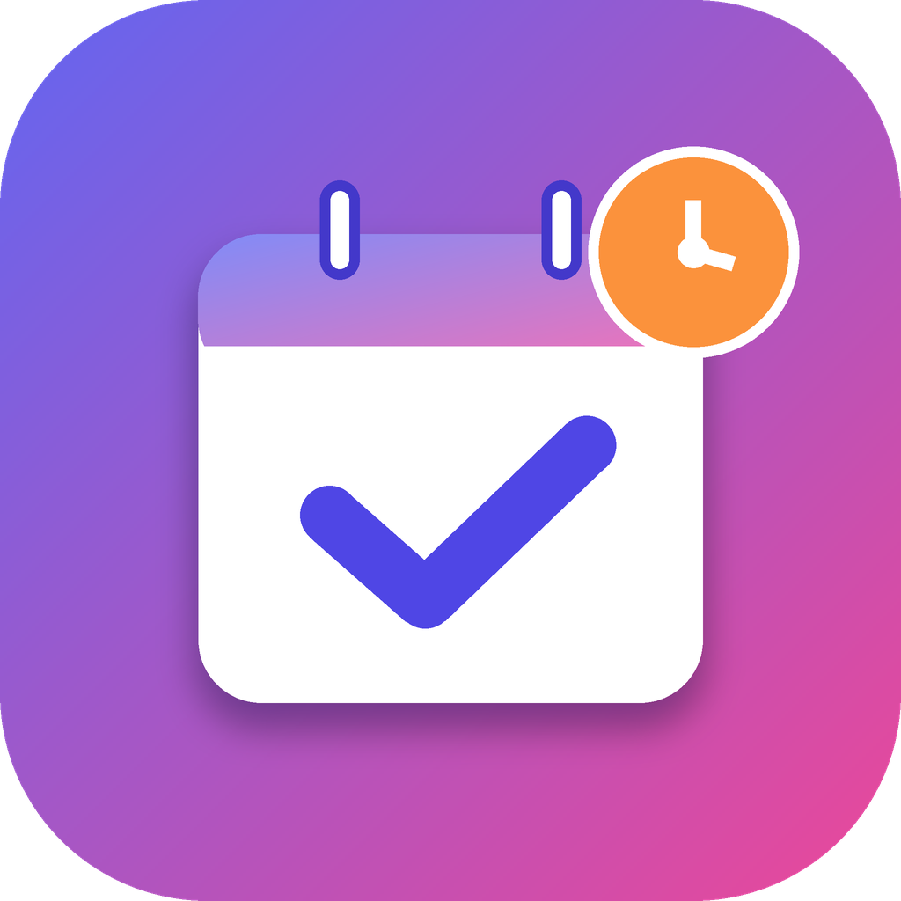
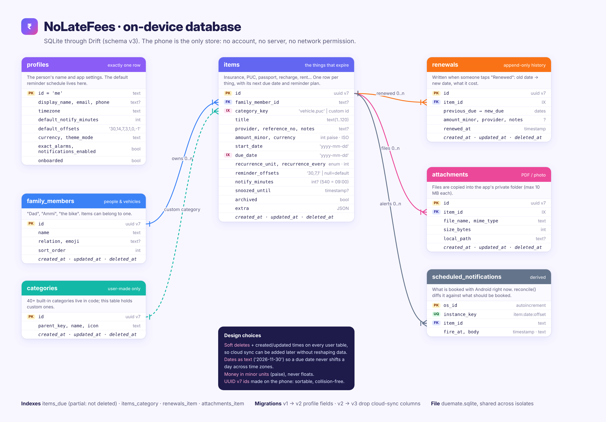
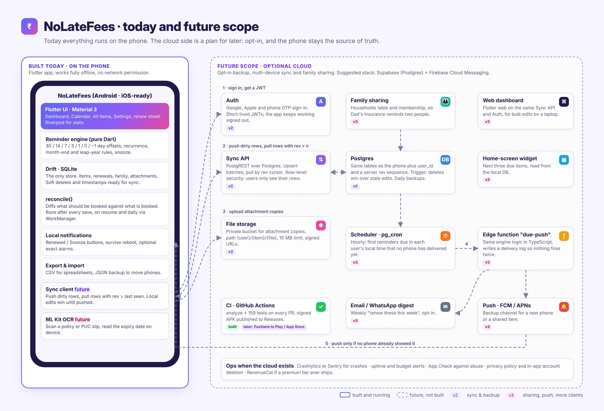

<p align="center">
  
</p>

<h1 align="center">NoLateFees</h1>

<p align="center">
  <b>Never pay a late fee again.</b><br/>
  A private, offline reminder app for everything that expires: insurance, PUC, passport, recharges, EMIs, subscriptions and warranties.
</p>

<p align="center">
  
  
  
  
  
</p>

---

## The problem

Late fees rarely happen because someone can't pay. They happen because a date slipped: the car insurance lapses, the PUC certificate runs out, a subscription renews on its own, an EMI date passes. Those dates live in emails, SMS, paper and a dozen apps.

NoLateFees keeps them in one list and nudges you early enough to act, without asking you to create an account or trust a server with your documents.

## Highlights

- 🔔 **Reminders that actually arrive.** 30, 14, 7, 3 and 1 day before, on the day and the day after, at the time you pick. They are re-booked after reboots and app updates, with a daily background top-up.
- 🔁 **One-tap renewals.** "Renewed" on the notification moves the due date to the next cycle (monthly, quarterly, yearly or custom) and keeps a renewal history with what you paid.
- 🗂️ **40+ built-in types in 8 categories** (Vehicle, Insurance, Mobile, Finance, Documents, Subscriptions, Home, Custom), plus your own.
- 👪 **Family and vehicles.** Track Dad's health policy, Ammi's passport and the bike's PUC, and filter by person.
- 📎 **Attachments.** Keep the policy PDF or a photo of the bill with the item.
- 📅 **Dashboard and calendar.** Overdue, due today, next 7 days, next 30 days and later, plus a month view.
- 🔒 **Private by design.** No login, no cloud, no ads, no analytics. The Android build does not even request the internet permission.
- 💾 **Your data stays portable.** Export to CSV for spreadsheets, or a JSON backup you can restore on a new phone.

## Architecture

Everything runs on the phone. The UI reads from a local SQLite database, a pure-Dart reminder engine works out what should fire, and one idempotent `reconcile()` function keeps the operating system's alarms in step with it.

```text
 Flutter UI (Riverpod)
        │  save / edit / renew / delete
        ▼
 ItemRepository ──► Drift (SQLite) ── the only store
        │
        ▼
 reconcile()  ◄── reminder engine (pure Dart, unit tested)
        │        runs after every write, on app resume, on time-zone change
        ▼        and once a day via WorkManager
 flutter_local_notifications ──► Android / iOS alarms
        ▲
        └── "Renewed" / "Snooze 1 day" buttons work with the app closed
```

### Database design

<p align="center"></p>

A few choices worth calling out:

- **Dates are stored as text** (`2026-11-30`), so a due date never shifts by a day when the phone changes time zone.
- **Money is stored in minor units** (paise), never as floating point.
- **IDs are UUID v7**, generated on the phone, so they sort by time and never collide.
- **Soft deletes and timestamps on every table**, so a sync backend can be added later without reshaping the data.
- **`scheduled_notifications` mirrors what is booked with the OS.** `reconcile()` diffs it against what *should* be booked and only cancels or adds the difference, which keeps it fast and safe to call any number of times.

### Future scope

<p align="center"></p>

The app is complete as a local-only product. If it grows, the plan is an **opt-in** cloud layer where the phone stays the source of truth: sign-in, multi-device sync with a server revision cursor, encrypted attachment storage, family sharing, a server-side push as a backup channel, on-device OCR to read expiry dates from scanned documents, a home-screen widget and a web dashboard.

## Tech stack

| Layer | Choice | Why |
|---|---|---|
| UI | Flutter, Material 3, flutter_animate | One codebase for Android and iOS |
| State | Riverpod | Little boilerplate, easy to test |
| Storage | Drift (SQLite) | Typed queries, reactive streams, tested migrations |
| Reminders | flutter_local_notifications, timezone, WorkManager | Exact local-time alarms with a daily safety net |
| Files | file_picker, path_provider, open_filex, share_plus | Attachments and exports without any server |
| CI | GitHub Actions | Analyze and test every PR; build a signed APK on demand |

## Quality

- **159 automated tests**, run on every pull request: the reminder engine (month-end and leap-year renewals, DST, notification caps), the repository and scheduler, backup round-trips, database migrations, widget tests for every screen in light and dark themes and at large text sizes, and accessibility checks such as labelled controls and 48 dp tap targets.
- **Config tests** guard the local-only promise: they fail the build if a cloud, sign-in or ad SDK, or the internet permission, ever comes back.
- **Migrations are tested** from every earlier schema version, so existing installs keep their data.

```bash
flutter test     # all 159 tests
```

See [docs/TESTING.md](docs/TESTING.md) for what each test file covers and a manual checklist for a real phone.

## Try it

**On an Android phone:** open the [Releases](../../releases) page, download `NoLateFees.apk` from the latest build and open it. These builds are signed with a public test key, so install updates only from this repo.

**From source:**

```bash
git clone https://github.com/AbhishekRay109/NoLateFees.git
cd NoLateFees
flutter pub get
dart run build_runner build --delete-conflicting-outputs   # generates the Drift database code
flutter test
flutter run
```

[docs/PHONE_SETUP.md](docs/PHONE_SETUP.md) walks through installing Flutter and running on a phone over USB. iOS is configured but has not been tested on a device.

## Project layout

```text
lib/
  domain/            reminder engine and categories (pure Dart, no Flutter)
  data/
    local/           Drift tables, migrations
    notifications/   reconcile() and the OS notification gateway
    backup/          CSV export, JSON backup and restore
    item_repository.dart, attachment_service.dart
  features/          dashboard, calendar, items, settings, onboarding
  widgets/           shared UI pieces
test/                unit, widget, migration and QA tests
docs/                testing guide, phone setup, diagrams (sources in docs/diagrams-src)
```

## History

NoLateFees started as a Play Store app with Google and phone sign-in, Firebase sync and a banner ad. It is now a local-only open-source project: the cloud, login and ads were removed, and the database dropped its sync columns in a tested migration. The future-scope diagram above shows how sync could return as an opt-in feature without giving up the offline-first design.

## Contact

Found a bug or have an idea? Open an issue, or use **Settings → Contact us** in the app.
