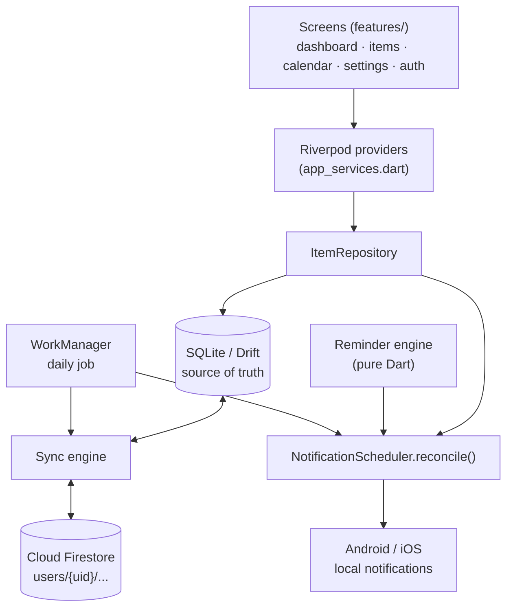

<p align="center">
  
</p>

<h1 align="center">NoLateFees</h1>

<p align="center">
  <b>One app that remembers every date you'd rather not:</b><br/>
  insurance, PUC, passport, recharges, EMIs, subscriptions, warranties and more.
</p>

<p align="center">
  
  
  
  
  
</p>

---

NoLateFees is a personal side project, not a store app. It is free to use: build it yourself or install the test APK on your Android phone (see [Install on your phone](#install-on-your-phone)).

## Table of contents

- [Why](#why)
- [Features](#features)
- [Install on your phone](#install-on-your-phone)
- [Build from source](#build-from-source)
- [Optional: sign-in, cloud sync and ads](#optional-sign-in-cloud-sync-and-ads)
- [Tech stack](#tech-stack)
- [Architecture](#architecture)
- [How the important parts work](#how-the-important-parts-work)
- [Project layout](#project-layout)
- [Testing](#testing)
- [Privacy and security](#privacy-and-security)
- [Roadmap](#roadmap)
- [Contributing](#contributing)
- [Contact](#contact)

## Why

Late fees and lapsed renewals usually happen because a date slipped your mind, not because you couldn't pay: car insurance expires, the PUC certificate runs out, a subscription renews on its own, an EMI date passes. These dates are spread across emails, SMS, paper and apps. NoLateFees keeps all of them in one list and reminds you early enough to act.

## Features

### Tracking
- **Dashboard** grouped into *Overdue*, *Due today*, *Next 7 days*, *Next 30 days*, *Upcoming* and *No date*, with a "things to renew" count.
- **Quick entry**: add an item in under 30 seconds.
- **8 built-in categories** with 40+ types, plus your own custom categories:

  | Category | Examples |
  |---|---|
  | 🚗 Vehicle | Insurance, PUC, RC, service, FASTag, road tax |
  | 🛡️ Insurance | Health, life, term, home, travel |
  | 📱 Mobile & Internet | Recharge, postpaid bill, broadband, SIM validity |
  | 💰 Finance | EMI, loan payment, credit card payment, rent |
  | 📄 Documents | Passport, visa, driving licence, ID, certificates, permits |
  | 📺 Subscriptions | Netflix, Spotify, YouTube, Prime, gym, software, cloud storage |
  | 🏠 Home | Appliance warranty, AC service, pest control, rental agreement |
  | ✏️ Custom | Anything else |

- **Family members and vehicles**: track items per person or per vehicle and filter by them.
- **Attachments**: keep the policy PDF or a photo of the bill (PDF, JPG, PNG) with the item.
- **Monthly calendar** view of everything that's due.
- **Search, filter** (category, status, person), **sort** and **archive**.

### Reminders
- **Alerts per item**: 30, 14, 7, 3 and 1 days before, on the day, 1 day after, or any custom offset, at the time you choose.
- **Recurring renewals**: monthly, every 3 or 6 months, yearly, or custom.
- **Renewed flow**: tap *Renewed* and it sets the next due date and keeps the renewal history.
- **Notification buttons**: *Renewed* and *Snooze 1 day*, which work even when the app is closed.
- **Survives reboots and app updates**: reminders are booked again automatically.
- **Exact timing is opt-in**: alarms are inexact by default, so no special permission is needed.

### Data and accounts
- **Works fully offline with no account.** Everything lives on your phone.
- **Optional sign-in** with Google or phone number (OTP), with cloud backup and sync across phones.
- **Export** to CSV, plus **JSON backup and restore**.
- **Sign out and delete account** from inside the app.

### Look and feel
- Colourful, animated UI with light and dark themes.
- Settings for default reminder time and schedule, theme, currency and your name.
- At most one small banner ad on *Home* and *All Items*, and none if you build without ads. No pop-ups, no full-screen ads.

## Install on your phone

**Android, quickest way:**

1. Open the repo's **[Releases](../../releases)** page on your phone.
2. Download `NoLateFees.apk` from the latest *test build*.
3. Open it and allow *Install unknown apps* for your browser when Android asks.
4. Allow notifications when the app asks, otherwise reminders can't show.

> These test builds are signed with a public test key. They are fine for personal use, but install updates only from this repo.

**Build it yourself:** follow [Build from source](#build-from-source) and run it on a phone connected by USB. [docs/PHONE_SETUP.md](docs/PHONE_SETUP.md) walks through every step, from installing Flutter to the first run.

**iOS:** the project is configured for iOS but hasn't been tested on a device yet.

## Build from source

### Prerequisites
- Flutter (stable channel, 3.x) and Dart 3
- Android Studio with the Android SDK, or Xcode for iOS
- `flutter doctor` showing green ticks for Flutter and your target toolchain

### Run in offline mode (no setup needed)

```bash
git clone https://github.com/AbhishekRay109/NoLateFees.git
cd NoLateFees
flutter pub get
dart run build_runner build --delete-conflicting-outputs   # generates the Drift database code
flutter test
flutter run
```

That's it. The app works fully offline and uses Google's test ad unit in debug builds.

### Build a release APK

```bash
flutter build apk --release                                    # offline build
flutter build apk --release --dart-define-from-file=env.json   # with your Firebase/AdMob ids
flutter build apk --release --dart-define=ADS_ENABLED=false    # without ads
```

The APK is written to `build/app/outputs/flutter-apk/app-release.apk`. Without your own `android/key.properties` it is signed with the public test key. For real ads, also export `ADMOB_APP_ID` before building, because the Android manifest reads it at build time.

## Optional: sign-in, cloud sync and ads

Sign-in, sync and real ads use **your own** Firebase project and AdMob account. No project IDs are committed to this repo.

1. Create a Firebase project and set it up by following [docs/FIREBASE_SETUP.md](docs/FIREBASE_SETUP.md). This covers Google and phone sign-in, Firestore, optional Storage and the security rules.
2. Optionally create an AdMob app and banner unit by following [docs/ADS_SETUP.md](docs/ADS_SETUP.md).
3. Copy the template and fill it in. `env.json` is git-ignored, so it stays on your machine.

   ```bash
   cp env.example.json env.json
   ```

   | Key | What it is |
   |---|---|
   | `FIREBASE_API_KEY` | Firebase Android API key |
   | `FIREBASE_APP_ID` | Firebase Android app ID |
   | `FIREBASE_MESSAGING_SENDER_ID` | Firebase project number |
   | `FIREBASE_PROJECT_ID` | Firebase project ID |
   | `FIREBASE_STORAGE_BUCKET` | Storage bucket (optional, needed only for attachment sync) |
   | `GOOGLE_SERVER_CLIENT_ID` | Web OAuth client ID, needed for Google Sign-In |
   | `ADMOB_APP_ID` / `ADMOB_BANNER_ID` | Your AdMob app and banner unit |

4. Run with:

   ```bash
   flutter run --dart-define-from-file=env.json
   ```

**GitHub Actions build:** the workflow in `.github/workflows/apk.yml` builds a test APK and publishes it as a pre-release. To turn on sign-in and real ads there, add a repository secret named `APP_ENV_JSON` with the same JSON (*Settings → Secrets and variables → Actions*). Without the secret, CI builds an offline APK with test ads.

## Tech stack

| Area | Choice |
|---|---|
| UI | Flutter, Material 3, `flutter_animate`, `table_calendar` |
| State | Riverpod |
| Local database | SQLite via **Drift** (code-generated, typed queries, migrations) |
| Notifications | `flutter_local_notifications` + `timezone` |
| Background work | WorkManager (daily reconcile job) |
| Auth (optional) | Firebase Auth: Google Sign-In and phone OTP |
| Cloud (optional) | Cloud Firestore (sync), Firebase Storage (attachments) |
| Ads (optional) | Google Mobile Ads, banner only |
| CI | GitHub Actions: tests, then build and publish the APK |

## Architecture



- **`domain/`** is pure Dart with no Flutter imports. It decides *when* to remind, handles recurrence, works out status and diffs schedules. This makes it fast and easy to unit-test.
- **`data/`** owns persistence, notifications, auth, sync, backup and attachments.
- **`features/`** contains the screens, which only talk to repositories and providers.

## How the important parts work

**Offline first.** Every write goes to SQLite first. The app never waits on the network, and the cloud is only a backup and sync target.

**Reminders as data.** Each item stores its schedule (`reminder_offsets`, `notify_minutes`). `NotificationScheduler.reconcile()` works out which alerts *should* exist, keeping the nearest 400 on Android and 60 on iOS because iOS caps pending notifications at 64. It compares them with the `scheduled_notifications` table and books or cancels only the difference. Reconcile runs after every change, on app open and resume, after a sync, and once a day from WorkManager, so alerts don't silently go missing.

**Conflict-safe sync.** Local writes are marked `dirty`. Sync pushes dirty rows (upsert), then pulls rows whose server revision is newer than the last pull. A row that is still dirty locally is never overwritten by a pull. Deletes are soft (`deleted_at`), and neither the app nor the Firestore rules allow undeleting, so a delete always beats an older edit. Each row is stored as a Firestore document at `users/{uid}/{table}/{id}`, and a server timestamp acts as the revision cursor.

**Dates without time zones.** Due dates are stored as calendar dates (`yyyy-mm-dd`), never timestamps, so a reminder can't shift by a day when time zones change. Status (overdue, due soon) is computed when the screen is drawn and never stored.

**Locked-down cloud data.** The Firestore and Storage rules in `firebase/` let each user read and write only their own tree, and they have their own emulator test suite in `firebase/rules-test/`.

## Project layout

```text
lib/
  core/                 config (build-time settings), theme, formatting
  domain/               pure Dart, no Flutter
    reminder_engine.dart    when to remind, recurrence, status, schedule diff
    categories.dart         built-in categories (shipped in the app, not stored)
  data/
    local/database.dart     Drift tables (mirror of the Firestore documents)
    item_repository.dart    every read/write the screens do
    notifications/          reconcile() + local notifications gateway
    auth/                   AuthService + Firebase (Google, phone OTP)
    sync/                   push/pull engine, Firestore backend, field mapping
    backup/                 CSV/JSON export and import
    ads/                    banner ad wrapper
    attachment_service.dart
  features/             screens: dashboard, items, calendar, settings, auth, shell
  widgets/              shared widgets (item tile, offsets picker, ad slot, brand)
  app_services.dart     wiring + Riverpod providers
  main.dart             startup, background job, notification taps
firebase/               Firestore and Storage security rules + rules tests
assets/logo/            app logo and launcher icon sources
test/                   unit, widget and QA tests
docs/                   setup, testing and release guides
.github/workflows/      CI: test, build and publish the APK
```

## Testing

```bash
flutter analyze
flutter test
```

The suite has 180+ tests covering:

- the reminder engine (offsets, recurrence, status, edge dates)
- the notification scheduler and its reconcile diff
- the repository, database migrations and CSV/JSON export and import
- sync logic and the Firestore mapping (using `fake_cloud_firestore`)
- auth flows (phone normalisation, profile merge, sign-out, account deletion)
- widgets and screens
- QA release checks (`test/qa/`): app ID, signing, permissions, ad policy, and that no secrets are committed

To run the security rules tests, use the Firebase emulator:

```bash
cd firebase/rules-test && npm install && npm test
```

Manual test walkthroughs are in [docs/TESTING.md](docs/TESTING.md) and [docs/PRODUCTION_QA_CHECKLIST.md](docs/PRODUCTION_QA_CHECKLIST.md).

## Privacy and security

- **No account needed.** In offline mode your data never leaves your phone.
- **Signed-in users** get their data stored under their own Firestore path, and the security rules block everyone else.
- **No secrets in the repo.** Firebase and AdMob IDs are supplied at build time through `env.json` (git-ignored) or a CI secret. `env.example.json` is an empty template.
- **Signing.** `android/app/ci-test.jks` is a *test-only* signing key with a public password, committed on purpose so CI builds keep one SHA-1 for Firebase. Never use it for a store release. Play Store bundles (`flutter build appbundle`) refuse to build without your own `android/key.properties` (see [docs/RELEASE.md](docs/RELEASE.md)).
- **Minimal permissions**: internet, notifications, boot-completed (to restore reminders) and an opt-in exact-alarm permission.

## Roadmap

These are deliberately left for later:

- Home-screen widget
- OCR to read due dates from a photo of a document
- Server push (FCM) and Crashlytics
- Testing on iOS devices

## Contributing

Issues and pull requests are welcome. Before opening a PR, please:

1. Run `flutter analyze` and `flutter test`, and make sure both are clean.
2. Keep business logic in `lib/domain/` (pure Dart) and add tests for it.
3. Re-run `dart run build_runner build --delete-conflicting-outputs` if you change `database.dart`.
4. Never commit `env.json`, `key.properties` or any real keys.

## Contact

Found a bug or have an idea? Open an [issue](../../issues), or use **Settings → Contact us** in the app.

Built by [Abhishek Ray](https://github.com/AbhishekRay109).
